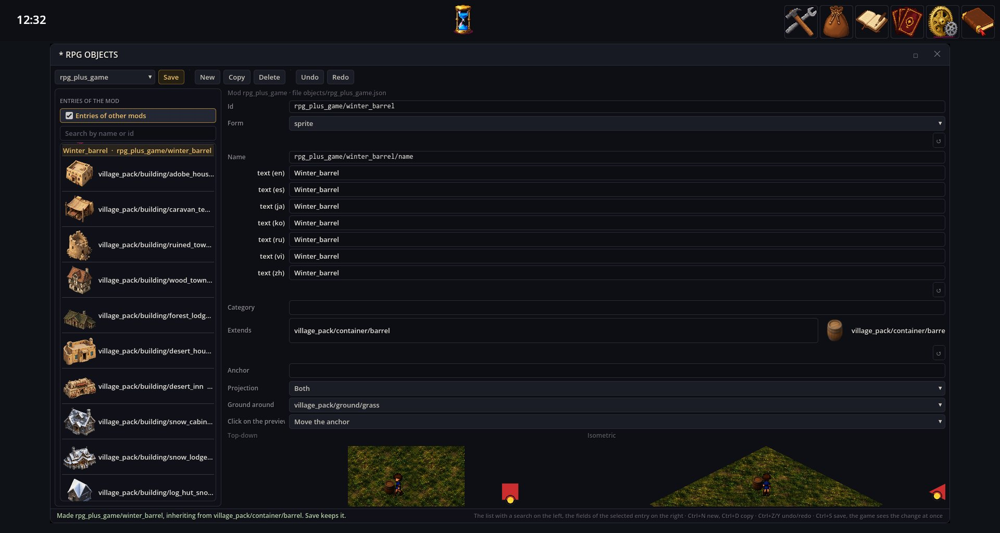
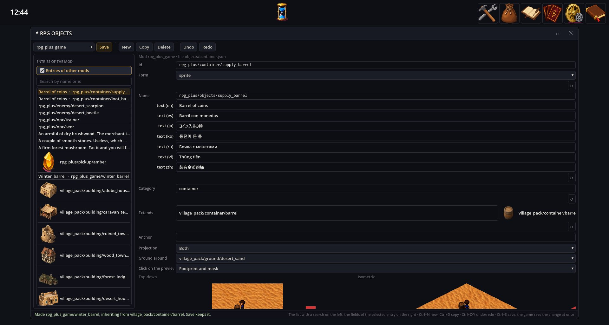

# RPG Object Editor — the objects of the RPG world in a form

The RPG Object Editor edits the objects of the RPG world: the ground materials, the walls and fence cells, the props on the grid, and the characters. Each object has pictures, a footprint on the grid, an anchor (the point it stands on), states, variants, lights, an optional route and an optional interaction. A preview beside the form draws the object in the **top-down** and the **isometric** projection, with the game's own renderer. **Save** writes the mod's file, and the game uses the object at once. No raw JSON is needed for normal work; the **Other fields** box stays for advanced use.

It opens from the tool box (the hammer on the toolbar) as **RPG objects**.

## An object in the editor

The list on the left holds the objects of the chosen mod, with a thumbnail for each. The form on the right edits the selected one. Here is the supply barrel of RPG Plus:

The toolbar has **Save** (Ctrl+S), **New** (Ctrl+N), **Copy** (Ctrl+D), **Delete**, **Undo** and **Redo** (Ctrl+Z, Ctrl+Y). A new object is a sprite with no picture yet, and its id starts with the mod's name followed by `new_object`.

## The forms

The fields depend on the object's **Form**, chosen at the top of the form:

- **Surface** — a ground material: its picture (a square of the map's patch size), **Blend into neighbours** and the blend width, **Water**, and the picture of its variants.
- **Segment** — one wall or fence cell: its picture, **Connect** (segments with the same key join each other), **Along** (the direction of the vertical plane in isometric), **Height** in cells, and the picture of its variants.
- **Sprite** — an object on the grid: its **parts** (pictures), its **footprint** (width and height in cells, and the mask), its **anchor**, flags, interaction, states, variants, lights and route.
- **Actor** — a character on one cell: its **Charset** (the walking sheet), **Facing**, **Column**, interaction, states, variants, lights and route.

All forms have **Id**, **Name** (a text in each language of the mod, stored in the locale files), **Category** (a tag for the palette: `container`, `vegetation`, `building`…) and **Extends**, the id of a parent object.

## Pictures and PNG import

**Import PNG...** (in the *Picture* block) copies a PNG of your disk into `rpg_images/<category>/` of the edited mod and sets it as the object's picture: its first part, its surface or its segment. Nothing is generated. The file is checked first:

- a file that is not a PNG is refused, and nothing is copied;
- a sprite part should be a whole number of map cells on each side (the map's tile size is 32 pixels by default); other sizes are imported, with a warning that parts will be cut or leave gaps;
- a surface should be a square of the map's patch size (128 pixels by default); other sizes are imported with a warning;
- a name that already exists in `rpg_images/<category>/` is refused: choose another file name.

The pictures of the **parts** and of the **variants** are also chosen from the group with the **…** picker.

## Parts (sprite)

The **Parts** block lists the pictures of the object, one block per part: its **Id**, **Image** (picker or typed path), **Geometry** (`upright` stands on its anchor, `ground` lies on the ground, `plane` is a vertical plane, `quad` is a free quadrilateral), **Along** (for `plane`), **Crop** (x, y, w, h in picture pixels; empty is the whole picture), **Offset** (x, y in cells), **Size** (w, h in cells), **Corners** (four `x, y, z` points for `quad`) and **Shown in** (one projection, or both). **Add part**, **Move up**, **Move down** and **Remove part** change the order. While the object has no parts of its own, the parts it inherits from its **Extends** parent are listed read-only and marked with the parent. **Override** copies the parent's whole list into the object (the game reads a parts list as a whole, so all of them are copied), and then each part can be edited here.

## Footprint and solidity

**Width** and **Height** (cells) give the footprint. The grid under them is the **mask**: a click switches a cell between `#` (blocks walking) and `.` (free). A new size clears the mask back to the object's solidity. **Flags** holds **Blocks walking** (by form, yes or no), **Hidden** (not drawn, not solid, not interactive), **Water** and **Blend into neighbours** for surfaces, and the **Draw order** of the parts.

## Anchor

The anchor is the point of the object the game sorts and places by. On either preview, press and drag the yellow marker: the cell under the pointer becomes the anchor, at its centre (the values are written as cells from the object's top-left cell, for example `1.5, 2.5`). The **Anchor** field of the form holds the same value and can be typed.

## Interaction

The **Interaction** block sets what the player triggers on the object:

- **Trigger**: `Use` (the action key next to it) or `Step` (stepping onto its cell).
- **Choose scenario...** opens the list of the scenarios of all loaded mods. A scenario and a teleport cannot both be set: choosing one removes the other.
- **Choose map...** with **Column**, **Row** and **Facing on arrival** sets a teleport to a cell of another map.
- **Script lines** holds commands, one per line, run when the object is triggered.
- **Remove interaction** removes the whole block.

## States

A state changes the object while its condition holds: a chest that opens, a door that unlocks. The **States** block lists them, with **Add state**, **Remove state** and **Move up / down**. Each state has an **Id**, a **Condition** (for example `self.open == 1`; the last state whose condition holds wins), **Facing**, **Hidden**, **Blocks walking**, its own parts and its own interaction. The **Show** choice above the preview switches the preview to a state, so you see each state as the game draws it.

## Variants

A variant is a partial object used for a season or a look: a winter tree, a broken door. **Variants** lists them; **Variant name** and **Add variant** make one, and **Remove variant** deletes the selected one. A sprite variant edits its own parts; a surface or a segment variant takes a picture. **Show** picks a variant in the preview.

## Lights and route

**Main light** gives the object a light of its own (radius in cells, colour with its alpha as strength, position in cells). **Add light** adds further lights with their own positions. **Moves along a route** makes the object walk a fixed route: its **Steps** (comma-separated: `up`, `down`, `left`, `right`, `random`, `toward`, `away`, `wait`, `face_up` … `face_right`), **Seconds per step** and **Repeat**.

## Objects of other mods

**Entries of other mods** (checked by default) lists the objects of the mod's dependencies, marked with the owner: `↗ rpg`. The owner's file is never written. Editing such an object writes a patch file in your mod, `patches/rpg_object/<your mod>.json`, that holds only the values you changed. The game uses the owner's object with your patch on top.

- **Reset to inherited** removes your patch of the object, so the game sees the owner's values again.
- **Copy** of a foreign object makes an own object with a new id, which you can then change freely.
- Deleting a foreign object writes a `$delete` entry in the patch.

## Make a variant

**Make a variant**, under the preview, makes a new object of your own from the selected one, whether it is your object or another mod's. The new object's **Extends** names the selected object, and its form is the same. The name you type becomes its name in every language of the mod; the id is made from the name (`Winter barrel` becomes `<your mod>/winter_barrel`). The new object opens in the form and inherits everything: picture, parts, footprint, states and interaction. Change only what differs, then **Save**. The parent's picture is shown beside the Extends field.

## The preview

The preview sits under the fields and shows the selected object as the game reads it, including the changes you have not saved yet. **Show** chooses the default look, a variant or a state. The projection picker shows **Both** side by side, **Top-down** only, or **Isometric** only. The preview draws the object on a small sample map, not on the world map.

The **Ground around** dropdown (grass by default) picks the surface material under and around the object, so the transitions show; nothing is saved. For a sprite, two player figures stand next to it, one behind and one in front, to show the scale and the depth order in both projections. The **Click on the preview** dropdown decides what a press does: **Move the anchor** (drag the handle), or **Footprint and mask**: a click on a cell of the footprint switches it between blocking and free, and a click right of or below the footprint extends it.

## Using an object

- A sprite or an actor is placed on a map with the RPG Map Editor: its palette lists sprites in the **Sprites** tab and actors in the **Actors** tab. A saved object appears there at once.
- A sprite with an interaction starts its scenario, or teleports the player, when the player uses or steps on it.

## Deferred

These are not in this version:

- the parts of a sprite are copied as a whole list on **Override**, not one part at a time;
- the footprint grows right and down from the sprite's origin cell: cells left of or above the origin cannot be added;
- the preview draws the object on a small sample map, not on the world map.

## If something goes wrong

1. **The object does not appear.** It is in another mod, or the list is filtered: clear the search, or tick **Entries of other mods** for an owner's object.
2. **The preview shows one projection only, or a note says a projection is not loaded.** The render mod for that projection is not in the game.
3. **A change does not show in the game.** Save (Ctrl+S) first. Only saved files reach the game.
4. **A PNG import is refused.** Its message says why: not a PNG, an empty picture, or a name that already exists. Nothing is copied in that case.
5. **An object of another mod does not change.** Its file is not written; the patch in your mod carries the change, and **Reset to inherited** removes it again.
