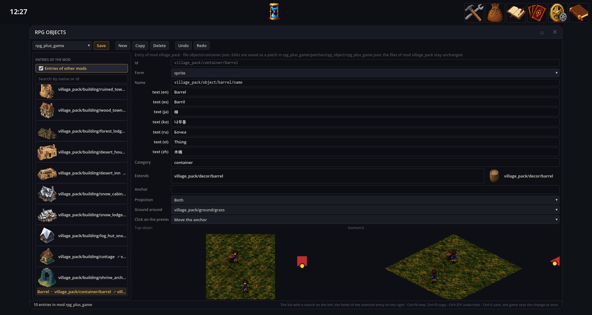

# RPG オブジェクトエディタ — RPG ワールドのオブジェクトをフォームで編集

RPG オブジェクトエディタは RPG ワールドのオブジェクトを編集します。地面の素材、壁や柵の区画、グリッド上の小物、キャラクターが対象です。各オブジェクトには、画像、グリッド上の占有範囲、アンカー（オブジェクトが立つ点）、状態、バリアント、光源、任意の経路、任意の操作があります。フォームの横のプレビューは、ゲーム自身のレンダラーで、**上から**と**アイソメトリック**の両方の投影にオブジェクトを描きます。**保存**でモッドのファイルが書き出され、ゲームはすぐにそのオブジェクトを使います。通常の作業に生の JSON は必要ありません。**その他のフィールド**欄は上級者向けに残されています。

ツールバーの道具箱（ハンマーのアイコン）から **RPG オブジェクト** として開きます。

パレット下の**新規オブジェクト…**で現在のマップの Mod にフォームを開きます。画像と動作を設定して保存するとパレットが更新され、選択して配置できます。

## エディタ内のオブジェクト

左のリストには、選んだモッドのオブジェクトが各サムネイル付きで並びます。右のフォームは選択中のオブジェクトを編集します。ここでは RPG Plus の補給樽を示します。

ツールバーには **保存**（Ctrl+S）、**新規**（Ctrl+N）、**複製**（Ctrl+D）、**削除**、**元に戻す**と**やり直し**（Ctrl+Z、Ctrl+Y）があります。新しいオブジェクトは画像がまだ無いスプライトで、その id はモッド名に `new_object` を続けたものになります。

## フォーム

フィールドは、フォーム上部で選ぶ **Form** によって変わります。

- **Surface**（サーフェス）— 地面の素材：画像（マップのパッチサイズの正方形）、**隣接する素材となじませる**と混ぜ幅、**水**、バリアントの画像。
- **Segment**（セグメント）— 壁や柵の一マス：画像、**Connect**（同じキーのセグメントは互いにつながる）、**Along**（アイソメトリックでの垂直面の向き）、マス単位の**高さ**、バリアントの画像。
- **Sprite**（スプライト）— グリッド上のオブジェクト：その**パーツ**（画像）、**占有範囲**（幅と高さのマス数およびマスク）、**アンカー**、フラグ、操作、状態、バリアント、光源、経路。
- **Actor**（アクター）— 一マスに立つキャラクター：その **Charset**（歩行シート）、**Facing**、**Column**、操作、状態、バリアント、光源、経路。

どのフォームにも **Id**、**Name**（モッドの各言語のテキスト。ローカライズファイルに保存されます）、**Category**（パレット用のタグ：`container`、`vegetation`、`building` など）、**Extends**（親オブジェクトの id）があります。

## 画像と PNG の取り込み

**PNG を取り込む...**（*画像* ブロック内）は、お使いのディスクの PNG を編集中のモッドの `rpg_images/<分類>/` にコピーし、オブジェクトの画像として設定します：最初のパーツ、サーフェス、またはセグメントです。生成は行いません。ファイルは先に検査されます：

- PNG でないファイルは拒否され、何もコピーされません；
- スプライトのパーツは、各辺がマップのマス（既定では 32 ピクセル）の整数倍であるべきです。それ以外のサイズは警告付きで取り込まれ、パーツが切れるかすき間が生じることを知らせます；
- サーフェスはマップのパッチサイズ（既定では 128 ピクセル）の正方形であるべきです。それ以外は警告付きで取り込まれます；
- `rpg_images/<分類>/` に既にある名前は拒否されます。別のファイル名を選んでください。

**パーツ**と**バリアント**の画像も、**…** ボタンでグループから選べます。

## パーツ（スプライト）

**パーツ** ブロックは、オブジェクトの画像を一覧にします。パーツごとに小さなブロックがあり、その **Id**、**Image**（選択または手入力のパス）、**Geometry**（`upright` はアンカーに立つ、`ground` は地面に寝る、`plane` は垂直面、`quad` は自由な四角形）、**Along**（`plane` 用）、**Crop**（画像ピクセルでの x、y、w、h。空欄は画像全体）、**オフセット**（マス単位の x、y）、**サイズ**（マス単位の w、h）、**角**（`quad` 用の四つの `x, y, z` 点）、**表示する投影**（一つの投影か両方）を編集します。**パーツを追加**、**上へ**、**下へ**、**パーツを削除** で順序を変えます。表は、オブジェクト自身のパーツを示します。**Extends** の親から継承したパーツはゲームで描画されますが、まだこの表には表示されません。

## 占有範囲と固さ

**幅**と**高さ**（マス）で占有範囲を定めます。その下のグリッドが**マスク**です：クリックで各マスを `#`（歩行を妨げる）と `.`（通行可能）の間で切り替えます。サイズを変えるとマスクはオブジェクトの固さの設定に戻ります。**フラグ** には **歩行を妨げる**（形状による、はい、いいえ）、**非表示**（描画されず、固くなく、操作もできない）、サーフェスの **水** と **隣接する素材となじませる**、そしてパーツの**描画順**があります。

## アンカー

アンカーは、ゲームがオブジェクトを並べ替え、配置するときの基準点です。どちらのプレビューでも黄色のマーカーを押したままドラッグします。ポインタの下のマスがアンカーになり、そのマスの中心に置かれます（値はオブジェクトの左上のマスからのマス数で書き込まれ、例えば `1.5, 2.5`）。フォームの **Anchor** 欄も同じ値を保持し、直接入力もできます。

## 操作

**操作** ブロックは、プレイヤーがオブジェクトで起動する内容を設定します：

- **トリガー**：`Use`（隣で決定キーを押す）または `Step`（そのマスに踏み込む）。
- **シナリオを選ぶ...** は、読み込まれた全モッドのシナリオ一覧を開きます。シナリオとワープは同時に設定できません：一方を選ぶと他方が外れます。
- **マップを選ぶ...** と **列**、**行**、**到着時の向き**で、別のマップの一マスへのワープを設定します。
- **スクリプト行** は命令です。一行に一つ、起動時に実行されます。
- **操作を削除** で、ブロック全体を外します。

## 状態

状態は、その条件が成り立つ間、オブジェクトを変えます：開く宝箱、解錠される扉など。**状態** ブロックがそれらを一覧し、**状態を追加**、**状態を削除**、**上へ / 下へ** があります。各状態には **Id**、**条件**（例：`self.open == 1`。条件が成り立つ最後の状態が優先）、**Facing**、**非表示**、**歩行を妨げる**、自分のパーツと自分の操作があります。プレビューの上の**表示**で状態に切り替えると、ゲームが描く各状態を確認できます。

## バリアント

バリアントは、季節や外観のための部分的なオブジェクトです：冬の木、壊れた扉など。**バリアント** が一覧を示し、**バリアント名**と**バリアントを追加**で作成、**バリアントを削除**で選択中のものを消します。スプライトのバリアントは自分のパーツを編集します。サーフェスやセグメントのバリアントは画像を指定します。**表示**でプレビューのバリアントを選びます。

## 光源と経路

**主な光源**は、オブジェクト自身の光を与えます（マス単位の半径、色のアルファが強さ、マス単位の位置）。**光源を追加**で、それぞれ位置を持つ光を増やせます。**経路に沿って動く**は、オブジェクトに決まった経路を歩かせます：その **ステップ**（カンマ区切り：`up`、`down`、`left`、`right`、`random`、`toward`、`away`、`wait`、`face_up` … `face_right`）、**一歩あたりの秒数**、**繰り返す**です。

## 他のモッドのオブジェクト

**他のモッドの項目**（既定でオン）は、モッドの依存先のオブジェクトを、所有者の印付きで一覧します：`↗ rpg`。所有者のファイルは決して書き換えられません。そのようなオブジェクトを編集すると、あなたのモッドに `patches/rpg_object/<あなたのモッド>.json` というパッチファイルが書かれ、変更した値だけを持ちます。ゲームは所有者のオブジェクトに、あなたのパッチを重ねて使います。

- **継承された値に戻す** は、そのオブジェクトへのパッチを外し、ゲームは再び所有者の値を見ます。
- 他のモッドのオブジェクトを**複製**すると、新しい id を持つ自分のオブジェクトができ、自由に変更できます。
- 他のモッドのオブジェクトを削除すると、パッチに `$delete` の項目が書かれます。

## プレビュー

プレビューはフィールドの下にあり、保存前の変更も含めて、ゲームが読み取る通りの選択中のオブジェクトを示します。**表示**で通常の見た目、バリアント、状態を選べます。投影の選択で **両方** を並べて、**上から**だけ、または**アイソメトリック**だけを表示できます。プレビューは、ワールドマップではなく小さなサンプルマップにオブジェクトを描きます。

## オブジェクトの使い方

- スプライトやアクターは RPG マップエディタでマップに置きます：そのパレットは **スプライト** タブにスプライトを、**アクター** タブにアクターを並べます。保存したオブジェクトはすぐそこに現れます。
- 操作のあるスプライトは、プレイヤーが使ったり踏んだりすると、そのシナリオを始めるか、プレイヤーをワープさせます。

## 保留中

このバージョンには含まれていません：

- **Extends** から継承したパーツは、パーツ表には表示されません（ゲームとプレビューでは描画されます）；
- プレビュー上で直接ブラシを使って占有範囲を塗ること（現時点ではフォーム内のマスクグリッドが編集手段です）；
- サーフェスのプレビューの隣接素材、およびスプライトのプレビューのプレイヤーの姿；
- **Extends** の親オブジェクトのサムネイル；
- オブジェクトの子を作るボタン：**Extends** は手で設定してください。

## うまくいかないとき

1. **オブジェクトが表示されない。** 別のモッドにあるか、一覧が絞り込まれています：検索を消すか、所有者のオブジェクトに対して**他のモッドの項目**をオンにしてください。
2. **プレビューに一つの投影しか出ない、または投影が読み込まれていない旨の注記がある。** その投影のレンダリングモッドがゲームに入っていません。
3. **変更がゲームに反映されない。** まず保存（Ctrl+S）してください。ゲームに届くのは保存されたファイルだけです。
4. **PNG の取り込みが拒否された。** メッセージに理由が出ます：PNG でない、画像が空、または名前が既に使われている。その場合は何もコピーされません。
5. **他のモッドのオブジェクトが変わらない。** そのファイルは書き換えられません。あなたのモッドのパッチが変更を運び、**継承された値に戻す**でそれを外せます。
