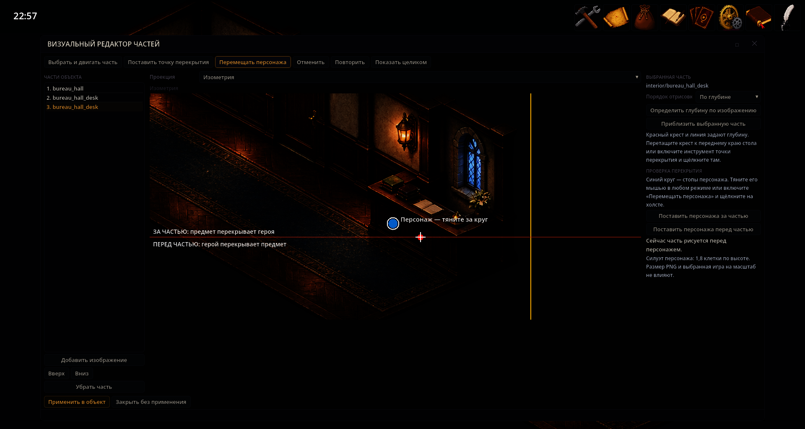
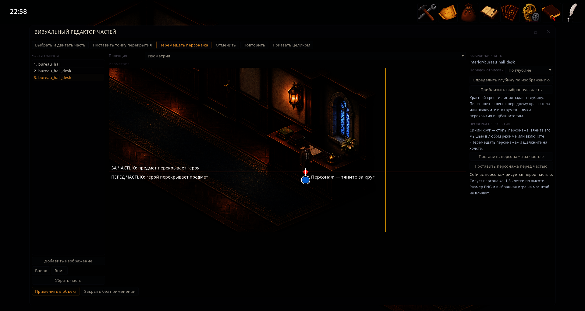
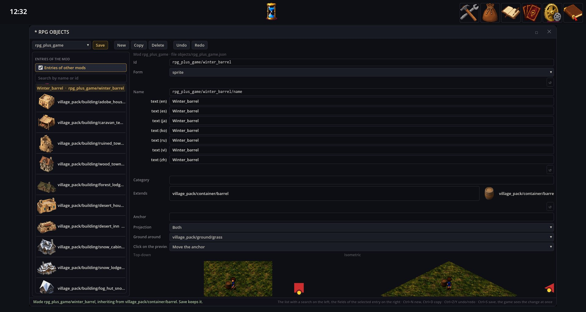
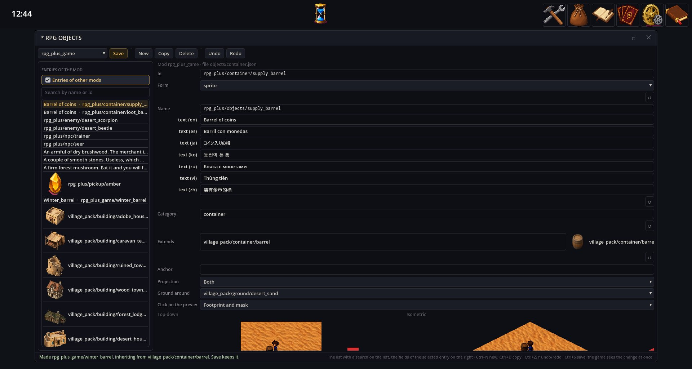

# Редактор объектов RPG — объекты мира RPG в форме

Редактор объектов RPG правит объекты мира RPG: материалы земли, стены и звенья ограды, предметы на сетке и персонажей. У каждого объекта есть картинки, след на сетке, якорь (точка, на которой он стоит), состояния, варианты, свет, необязательный маршрут и необязательное взаимодействие. Предпросмотр рядом с формой рисует объект в проекциях **сверху** и **изометрия**, собственным рендерером игры. **Сохранить** пишет файл мода, и игра сразу использует объект. Для обычной работы сырой JSON не нужен; поле **Прочие поля** остаётся для продвинутых пользователей.

Открывается из панели инструментов (молоток на панели) как **Объекты RPG**.

Для предмета или NPC с картинкой нажмите **Новый объект…** под палитрой: форма откроется сразу в моде текущей карты. Задайте картинку и взаимодействие, сохраните объект, затем выберите его в обновившейся палитре и поставьте на карту.

## Визуальное редактирование частей

Выберите объект формы **sprite** и нажмите **Визуальный редактор частей** над предпросмотром. Окно устроено как редактор карты: **слева список частей**, в центре холст, справа настройки выбранной части и проверка перекрытия. ЛКМ выбирает видимые пиксели картинки, прозрачные области пропускают выбор к нижележащей части. Двойной щелчок по строке списка или **Приблизить выбранную часть** показывает сам предмет крупно, учитывая его непрозрачную область. **Вверх / Вниз** меняют порядок частей.

На верхней панели три инструмента:

- **Выбрать и двигать часть** — ЛКМ переносит картинку, белые угловые маркеры меняют размер. У `quad` углы двигаются в плоскости клетки с сохранением высоты вершины.
- **Поставить точку перекрытия** — щёлкните по переднему краю стола. Красный крест и горизонтальная линия показывают границу глубины. Крест можно перетаскивать и без переключения инструмента.
- **Перемещать персонажа** — щёлкните или ведите мышью по холсту. Синий круг у стоп всегда доступен для перетаскивания в любом инструменте, даже когда фигуру скрывает стол. Справа есть кнопки **Поставить персонажа за частью / перед частью** и подпись текущего результата.

Для стола выберите справа **По глубине**. Если точка ещё не задана, редактор определит её по нижнему краю основного непрозрачного фрагмента PNG; отдельные обрезки и случайные пиксели не сдвигают результат. Можно повторить **Определить глубину по изображению** или перенести крест вручную. Общий якорь комнаты остаётся на месте.

**Под персонажами** всегда рисует героя сверху, **Над персонажами** всегда перекрывает героя. Для обхода стола с разных сторон нужен именно режим **По глубине**: выше красной линии часть закрывает героя, ниже герой закрывает часть.

Визуальный эталон персонажа имеет высоту **1,8 клетки по видимому силуэту**, с учётом прозрачных полей PNG. Стас из JRP и герой RPG Plus показываются в одинаковом масштабе; это масштаб эталона в редакторе. Положение синего круга совпадает с точкой стоп, используемой рендерером для сортировки.

Колесо увеличивает изображение вокруг указателя, средняя кнопка перемещает вид. **Показать целиком** возвращает весь объект. **Ctrl+Z / Ctrl+Y** отменяют и повторяют изменения, **Esc** отменяет текущее перетаскивание.

Для PNG, вырезанного из комнаты с сохранением размера холста, выберите основную картинку и нажмите **Добавить изображение**. Выбранный PNG получает её смещение, размер и ограничение проекции; точка глубины определяется по содержимому изображения. Если слой стола уже есть, выберите его в списке, не добавляя дубликат.

**Применить в объект** переносит рабочую копию в основной редактор одним шагом отмены. Обычное **Сохранить** записывает её и обновляет объекты уже открытой карты, сохраняя положение игрока и НПС. **Закрыть без применения** отбрасывает рабочую копию. Унаследованные части становятся своим переопределением; чужой объект сохраняется патчем. Неизвестные поля существующих частей сохраняются.

Здесь редактируются основные части объекта. Состояния и варианты остаются в основной форме. Для `plane` здесь доступны точка сортировки и проверочный персонаж; геометрия плоскости остаётся в основной форме. Обычные PNG (`upright`) и `ground` можно двигать и масштабировать мышью.

## Объект в редакторе

Список слева содержит объекты выбранного мода, с миниатюрой у каждого. Форма справа правит выбранный объект. Вот бочка снабжения из RPG Plus:

На панели есть **Сохранить** (Ctrl+S), **Новый** (Ctrl+N), **Копия** (Ctrl+D), **Удалить**, **Отменить** и **Повторить** (Ctrl+Z, Ctrl+Y). Новый объект — спрайт без картинки, его id начинается с имени мода и `new_object`.

## Формы

Поля зависят от **Form**, которую выбирают сверху формы:

- **Surface** — материал земли: картинка (квадрат размера патча карты), **Смешивать с соседями** и ширина смешивания, **Вода**, картинка вариантов.
- **Segment** — одна клетка стены или ограды: картинка, **Connect** (сегменты с одним ключом соединяются), **Along** (направление вертикальной плоскости в изометрии), **Высота** в клетках, картинка вариантов.
- **Sprite** — объект на сетке: его **части** (картинки), его **след** (ширина и высота в клетках и маска), **якорь**, флаги, взаимодействие, состояния, варианты, свет и маршрут.
- **Actor** — персонаж на одной клетке: **Charset** (лист походки), **Facing**, **Column**, взаимодействие, состояния, варианты, свет и маршрут.

У всех форм есть **Id**, **Name** (текст на каждом языке мода, хранится в файлах локали), **Category** (метка для палитры: `container`, `vegetation`, `building`…) и **Extends** — id объекта-родителя.

## Картинки и импорт PNG

**Импорт PNG...** (блок *Картинка*) копирует PNG с вашего диска в `rpg_images/<категория>/` редактируемого мода и делает её картинкой объекта: его первой части, его поверхности или его сегмента. Ничего не генерируется. Файл проверяется заранее:

- файл, который не PNG, отклоняется, и ничего не копируется;
- часть спрайта должна занимать целое число клеток карты по каждой стороне (размер клетки по умолчанию 32 пикселя); другие размеры импортируются с предупреждением, что части обрежутся или оставят зазоры;
- поверхность должна быть квадратом размера патча карты (по умолчанию 128 пикселей); другие размеры импортируются с предупреждением;
- имя, которое уже есть в `rpg_images/<категория>/`, отклоняется: выберите другое имя файла.

Картинки **частей** и **вариантов** тоже выбираются из группы кнопкой **…**.

## Части (спрайт)

Блок **Части** перечисляет картинки объекта, по блоку на часть: её **Id**, **Image** (выбор или путь вручную), **Geometry** (`upright` стоит на якоре, `ground` лежит на земле, `plane` — вертикальная плоскость, `quad` — свободный четырёхугольник), **Along** (для `plane`), **Crop** (x, y, w, h в пикселях картинки; пусто — вся картинка), **Смещение** (x, y в клетках), **Размер** (w, h в клетках), **Углы** (четыре точки `x, y, z` для `quad`) и **Показывать в** (одна проекция или обе). **Добавить часть**, **Вверх**, **Вниз** и **Убрать часть** меняют порядок. Пока у объекта нет собственных частей, части, которые он наследует от родителя по **Extends**, показаны только для чтения и помечены родителем. **Переопределить** копирует весь список родителя в объект (игра читает список частей целиком, поэтому копируются все), после чего каждую часть можно править здесь.

## След и твёрдость

**Ширина** и **Высота** (клетки) задают след. Сетка под ними — **маска**: щелчок переключает клетку между `#` (блокирует ходьбу) и `.` (свободна). Новый размер сбрасывает маску к твёрдости объекта. **Флаги** содержат **Блокирует ходьбу** (по форме, да или нет), **Скрыт** (не рисуется, не твёрдый, не интерактивный), **Вода** и **Смешивать с соседями** для поверхностей, а также **Порядок отрисовки** частей.

## Якорь

Якорь — точка объекта, по которой игра сортирует и ставит его. В любом предпросмотре нажмите и тяните жёлтый маркер: клетка под указателем становится якорем, по центру клетки (значения пишутся в клетках от левого верхнего угла следа, например `1.5, 2.5`). Поле **Якорь** формы хранит то же значение и может быть введено вручную.

## Взаимодействие

Блок **Взаимодействие** задаёт, что игрок запускает на объекте:

- **Триггер**: `Use` (клавиша действия рядом) или `Step` (шаг на его клетку).
- **Выбрать сценарий...** открывает список сценариев всех загруженных модов. Сценарий и телепорт нельзя задать вместе: выбор одного убирает другой.
- **Выбрать карту...** вместе с **Колонкой**, **Строкой** и **Взглядом при прибытии** задаёт телепорт в клетку другой карты.
- **Строки сценария** — команды, по одной в строке, выполняются при срабатывании.
- **Убрать взаимодействие** убирает весь блок.

## Состояния

Состояние меняет объект, пока его условие истинно: сундук открывается, дверь отпирается. Блок **Состояния** перечисляет их, с кнопками **Добавить состояние**, **Убрать состояние** и **Вверх / Вниз**. У каждого состояния есть **Id**, **Условие** (например `self.open == 1`; побеждает последнее состояние, чьё условие истинно), **Facing**, **Скрыт**, **Блокирует ходьбу**, свои части и своё взаимодействие. Выбор **Показать** над предпросмотром переключает его на состояние, так что каждое состояние видно таким, каким его рисует игра.

## Варианты

Вариант — частичный объект для сезона или вида: зимнее дерево, сломанная дверь. **Варианты** перечисляет их; **Имя варианта** и **Добавить вариант** создают новый, **Убрать вариант** удаляет выбранный. Вариант спрайта правит свои части; вариант поверхности или сегмента задаёт картинку. **Показать** выбирает вариант в предпросмотре.

## Свет и маршрут

**Основной свет** даёт объекту собственный свет (радиус в клетках, цвет, где альфа — сила света, положение в клетках). **Добавить свет** добавляет ещё огни со своими положениями. **Ходит по маршруту** заставляет объект идти по заданному пути: **Шаги** (через запятую: `up`, `down`, `left`, `right`, `random`, `toward`, `away`, `wait`, `face_up` … `face_right`), **Секунд на шаг** и **Повторять**.

## Объекты других модов

**Записи других модов** (включено по умолчанию) показывает объекты зависимостей мода с меткой владельца: `↗ rpg`. Файл владельца никогда не пишется. Правка такого объекта пишет в вашем моде файл патча `patches/rpg_object/<ваш мод>.json`, где только изменённые значения. Игра берёт объект владельца с вашим патчем поверх.

- **Сбросить к унаследованному** убирает ваш патч объекта, и игра снова видит значения владельца.
- **Копия** чужого объекта делает свой объект с новым id, который можно менять свободно.
- Удаление чужого объекта пишет в патч запись `$delete`.

## Сделать вариант

**Сделать вариант** под предпросмотром создаёт новый свой объект от выбранного, своего или чужого мода. **Extends** нового объекта указывает на выбранный, форма та же. Введённое имя станет названием на всех языках мода; идентификатор строится из имени (`Зимняя бочка` → `<ваш мод>/зимняя_бочка`, латиницей: `winter_barrel`). Новый объект открывается в форме и наследует всё: картинку, части, след, состояния и взаимодействие. Меняйте только отличия и нажмите **Сохранить**. Картинка родителя показана рядом с полем Extends.

## Предпросмотр

Предпросмотр стоит под полями и показывает выбранный объект таким, каким его видит игра, включая ещё не сохранённые правки. **Показать** выбирает обычный вид, вариант или состояние. Выбор проекций показывает **Обе** рядом, только **Сверху** или только **Изометрию**. Предпросмотр рисует объект на маленькой образцовой карте, а не на карте мира.

Список **Земля вокруг** (по умолчанию трава) выбирает материал поверхности под объектом и вокруг него, чтобы были видны переходы; ничего не сохраняется. Для спрайта рядом стоят две фигуры игрока, одна за объектом и одна перед ним: видно масштаб и порядок глубины в обеих проекциях. Список **Клик по предпросмотру** задаёт, что делает нажатие: **Двигать якорь** (тащить маркер) или **След и маска**: клик по клетке следа переключает её между блокировкой и свободной клеткой, а клик правее или ниже следа расширяет его.

## Использование объекта

- Спрайт или актёра ставят на карту в редакторе карт RPG: палитра показывает спрайты на вкладке **Спрайты**, актёров — на вкладке **Актёры**. Сохранённый объект появляется там сразу.
- Спрайт с взаимодействием запускает свой сценарий или телепортирует игрока, когда игрок использует его или на него наступает.

## Отложено

Этого в версии пока нет:

- «Переопределить» копирует у спрайта весь список частей, а не одну часть;
- след растёт вправо и вниз от опорной клетки спрайта: добавить клетки левее или выше опорной нельзя;
- предпросмотр рисует объект на небольшой образцовой карте, а не на карте мира.

## Если что-то пошло не так

1. **Объект не появляется.** Он в другом моде или список отфильтрован: очистите поиск или включите **Записи других модов** для объекта владельца.
2. **Предпросмотр показывает одну проекцию или пишет, что проекция не загружена.** Модуль рендера этой проекции не входит в игру.
3. **Правка не видна в игре.** Сначала сохраните (Ctrl+S). В игру попадают только сохранённые файлы.
4. **Импорт PNG отклонён.** Сообщение говорит почему: не PNG, пустая картинка или имя уже занято. В этом случае ничего не копируется.
5. **Объект другого мода не меняется.** Его файл не пишется; изменение несёт патч в вашем моде, а **Сбросить к унаследованному** его убирает.
