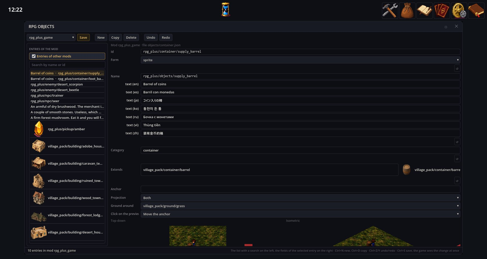

# Trình chỉnh sửa vật thể RPG — các vật thể của thế giới RPG trong một biểu mẫu

Trình chỉnh sửa vật thể RPG sửa các vật thể của thế giới RPG: vật liệu mặt đất, tường và ô hàng rào, đạo cụ trên lưới, và nhân vật. Mỗi vật thể có hình ảnh, vùng chiếm chỗ trên lưới, neo (điểm mà vật thể đứng trên), trạng thái, biến thể, đèn, một tuyến đường tùy chọn và một tương tác tùy chọn. Bản xem trước cạnh biểu mẫu vẽ vật thể theo hai phép chiếu **từ trên xuống** và **đẳng cự (isometric)**, bằng bộ dựng hình của chính trò chơi. **Lưu** ghi tệp của mod, và trò chơi dùng vật thể ngay lập tức. Công việc thông thường không cần JSON thô; ô **Trường khác** dành cho người dùng nâng cao.

Mở từ hộp công cụ (biểu tượng búa trên thanh công cụ) với tên **Vật thể RPG**.

## Vật thể trong trình chỉnh sửa

Danh sách bên trái hiển thị các vật thể của mod đã chọn, mỗi vật thể có ảnh thu nhỏ. Biểu mẫu bên phải sửa vật thể đang chọn. Đây là thùng vật tư của RPG Plus:

Thanh công cụ có **Lưu** (Ctrl+S), **Mới** (Ctrl+N), **Sao chép** (Ctrl+D), **Xóa**, **Hoàn tác** và **Làm lại** (Ctrl+Z, Ctrl+Y). Vật thể mới là một sprite chưa có hình, và id của nó bắt đầu bằng tên mod theo sau là `new_object`.

## Các biểu mẫu

Các trường phụ thuộc vào **Form**, chọn ở đầu biểu mẫu:

- **Surface** (bề mặt) — vật liệu mặt đất: hình (một hình vuông bằng kích thước mảng của bản đồ), **Hòa trộn với ô bên cạnh** và độ rộng hòa trộn, **Nước**, và hình của các biến thể.
- **Segment** (đoạn) — một ô tường hoặc hàng rào: hình, **Connect** (các đoạn có cùng khóa nối với nhau), **Along** (hướng mặt phẳng đứng trong đẳng cự), **Cao** tính bằng ô, và hình của các biến thể.
- **Sprite** — vật thể trên lưới: các **phần** (hình) của nó, **vùng chiếm chỗ** (rộng và cao tính bằng ô, và mặt nạ), **neo**, cờ, tương tác, trạng thái, biến thể, đèn và tuyến đường.
- **Actor** (nhân vật) — nhân vật đứng trên một ô: **Charset** (bảng dáng đi), **Facing**, **Column**, tương tác, trạng thái, biến thể, đèn và tuyến đường.

Mọi biểu mẫu đều có **Id**, **Name** (văn bản bằng mọi ngôn ngữ của mod, lưu trong tệp ngôn ngữ), **Category** (thẻ cho bảng màu: `container`, `vegetation`, `building`…) và **Extends** (id của vật thể cha).

## Hình ảnh và nhập PNG

**Nhập PNG...** (trong khối *Hình*) chép một PNG từ đĩa của bạn vào `rpg_images/<danh mục>/` của mod đang sửa và đặt làm hình của vật thể: phần đầu tiên, bề mặt hoặc đoạn. Không có gì được tạo ra. Tệp được kiểm tra trước:

- tệp không phải PNG bị từ chối và không chép gì;
- phần của sprite nên chiếm số nguyên ô bản đồ ở mỗi cạnh (kích thước ô mặc định là 32 điểm ảnh); các kích thước khác vẫn được nhập, kèm cảnh báo rằng phần sẽ bị cắt hoặc để lại khe hở;
- bề mặt nên là hình vuông bằng kích thước mảng của bản đồ (mặc định 128 điểm ảnh); kích thước khác vẫn được nhập kèm cảnh báo;
- tên đã có trong `rpg_images/<danh mục>/` bị từ chối: hãy chọn tên tệp khác.

Hình của **phần** và **biến thể** cũng có thể chọn từ nhóm bằng nút **…**.

## Các phần (sprite)

Khối **Các phần** liệt kê hình của vật thể, mỗi phần một khối: **Id**, **Image** (bộ chọn hoặc đường dẫn gõ tay), **Geometry** (`upright` đứng trên neo, `ground` nằm trên mặt đất, `plane` là mặt phẳng đứng, `quad` là tứ giác tự do), **Along** (cho `plane`), **Crop** (x, y, w, h theo điểm ảnh của hình; để trống là toàn bộ hình), **Độ lệch** (x, y theo ô), **Kích thước** (w, h theo ô), **Góc** (bốn điểm `x, y, z` cho `quad`) và **Hiển thị trong** (một phép chiếu hoặc cả hai). **Thêm phần**, **Lên**, **Xuống** và **Bỏ phần** đổi thứ tự. Bảng chỉ hiển thị các phần của chính vật thể; các phần kế thừa từ cha qua **Extends** được trò chơi vẽ nhưng hiện chưa liệt kê trong bảng.

## Vùng chiếm chỗ và độ rắn

**Rộng** và **Cao** (ô) xác định vùng chiếm chỗ. Lưới bên dưới là **mặt nạ**: nhấn để đổi một ô giữa `#` (chặn đường đi) và `.` (trống). Kích thước mới đặt lại mặt nạ về độ rắn của vật thể. **Cờ** gồm **Chặn đường đi** (theo hình dạng, có hoặc không), **Ẩn** (không vẽ, không rắn, không tương tác được), **Nước** và **Hòa trộn với ô bên cạnh** cho bề mặt, và **Thứ tự vẽ** của các phần.

## Neo

Neo là điểm của vật thể mà trò chơi dùng để sắp xếp và đặt vật thể. Trên bất kỳ bản xem trước nào, nhấn giữ và kéo dấu màu vàng: ô dưới con trỏ trở thành neo, đặt ở tâm ô (giá trị được ghi thành số ô tính từ ô góc trên bên trái của vật thể, ví dụ `1.5, 2.5`). Trường **Anchor** trên biểu mẫu giữ cùng giá trị và cũng có thể gõ tay.

## Tương tác

Khối **Tương tác** đặt điều người chơi kích hoạt trên vật thể:

- **Kích hoạt**: `Use` (phím hành động ở bên cạnh) hoặc `Step` (bước lên ô của nó).
- **Chọn kịch bản...** mở danh sách kịch bản của mọi mod đã tải. Kịch bản và dịch chuyển không thể đặt cùng lúc: chọn một cái sẽ bỏ cái kia.
- **Chọn bản đồ...** cùng với **Cột**, **Hàng** và **Hướng khi đến nơi** đặt một dịch chuyển đến một ô của bản đồ khác.
- **Dòng kịch bản** là các lệnh, mỗi dòng một lệnh, chạy khi kích hoạt.
- **Bỏ tương tác** xóa toàn bộ khối.

## Trạng thái

Trạng thái thay đổi vật thể trong khi điều kiện của nó đúng: một cái rương mở ra, một cánh cửa mở khóa. Khối **Trạng thái** liệt kê chúng, với **Thêm trạng thái**, **Bỏ trạng thái** và **Lên / Xuống**. Mỗi trạng thái có **Id**, **Điều kiện** (ví dụ `self.open == 1`; trạng thái đúng cuối cùng thắng), **Facing**, **Ẩn**, **Chặn đường đi**, các phần riêng và tương tác riêng. Mục **Hiển thị** phía trên bản xem trước chuyển bản xem trước sang một trạng thái, để bạn thấy từng trạng thái như trò chơi vẽ.

## Biến thể

Biến thể là một vật thể một phần dùng cho một mùa hoặc một diện mạo: cây mùa đông, cánh cửa hỏng. **Biến thể** liệt kê chúng; **Tên biến thể** và **Thêm biến thể** tạo một cái, **Bỏ biến thể** xóa cái đang chọn. Biến thể của sprite sửa các phần riêng; biến thể của bề mặt hoặc đoạn đặt một hình. **Hiển thị** chọn một biến thể trong bản xem trước.

## Đèn và tuyến đường

**Đèn chính** cho vật thể một nguồn sáng riêng (bán kính theo ô, màu mà alpha là cường độ, vị trí theo ô). **Thêm đèn** thêm các đèn nữa, mỗi đèn có vị trí riêng. **Di chuyển theo tuyến** khiến vật thể đi theo một tuyến cố định: các **Bước** (cách nhau bằng dấu phẩy: `up`, `down`, `left`, `right`, `random`, `toward`, `away`, `wait`, `face_up` … `face_right`), **Giây mỗi bước** và **Lặp lại**.

## Vật thể của mod khác

**Mục của mod khác** (mặc định bật) liệt kê vật thể của các phụ thuộc của mod, kèm dấu chủ sở hữu: `↗ rpg`. Tệp của chủ sở hữu không bao giờ bị ghi. Sửa vật thể như vậy sẽ ghi vào mod của bạn một tệp vá, `patches/rpg_object/<mod của bạn>.json`, chỉ chứa các giá trị bạn đã đổi. Trò chơi dùng vật thể của chủ sở hữu với bản vá của bạn đè lên.

- **Đặt lại về giá trị kế thừa** xóa bản vá của bạn cho vật thể, và trò chơi lại thấy giá trị của chủ sở hữu.
- **Sao chép** một vật thể của mod khác tạo ra một vật thể riêng với id mới mà bạn có thể đổi tùy ý.
- Xóa một vật thể của mod khác ghi mục `$delete` vào bản vá.

## Bản xem trước

Bản xem trước nằm dưới các trường và hiển thị vật thể đang chọn đúng như trò chơi đọc nó, kể cả những thay đổi chưa lưu. **Hiển thị** chọn diện mạo mặc định, một biến thể hoặc một trạng thái. Bộ chọn phép chiếu hiển thị **Cả hai** cạnh nhau, chỉ **Từ trên xuống**, hoặc chỉ **Đẳng cự**. Bản xem trước vẽ vật thể trên một bản đồ mẫu nhỏ, không phải bản đồ thế giới.

## Dùng vật thể

- Một sprite hoặc một nhân vật được đặt lên bản đồ bằng Trình chỉnh sửa bản đồ RPG: bảng màu của nó liệt kê sprite ở thẻ **Sprite** và nhân vật ở thẻ **Nhân vật**. Vật thể đã lưu hiện ra ở đó ngay.
- Một sprite có tương tác sẽ chạy kịch bản của nó, hoặc dịch chuyển người chơi, khi người chơi dùng hoặc bước lên nó.

## Chưa làm

Chưa có trong phiên bản này:

- các phần kế thừa từ **Extends** không được liệt kê trong bảng phần (trò chơi và bản xem trước vẫn vẽ chúng);
- vẽ vùng chiếm chỗ bằng cọ trực tiếp trên bản xem trước (hiện tại trình chỉnh sửa là lưới mặt nạ trong biểu mẫu);
- các vật liệu lân cận trong bản xem trước bề mặt, và hình người chơi trong bản xem trước sprite;
- ảnh thu nhỏ của vật thể cha trong **Extends**;
- nút tạo vật thể con: hãy đặt **Extends** bằng tay.

## Khi có lỗi

1. **Vật thể không xuất hiện.** Nó thuộc mod khác, hoặc danh sách đang được lọc: xóa ô tìm kiếm, hoặc bật **Mục của mod khác** để xem vật thể của chủ sở hữu.
2. **Bản xem trước chỉ hiện một phép chiếu, hoặc có ghi chú rằng một phép chiếu chưa được tải.** Mod dựng hình của phép chiếu đó không có trong trò chơi.
3. **Thay đổi không hiện trong trò chơi.** Hãy lưu trước (Ctrl+S). Chỉ các tệp đã lưu mới đến được trò chơi.
4. **Nhập PNG bị từ chối.** Thông báo cho biết lý do: không phải PNG, hình trống, hoặc tên đã có. Trong trường hợp đó không chép gì cả.
5. **Vật thể của mod khác không đổi.** Tệp của nó không được ghi; bản vá trong mod của bạn mang thay đổi, và **Đặt lại về giá trị kế thừa** sẽ xóa nó.
